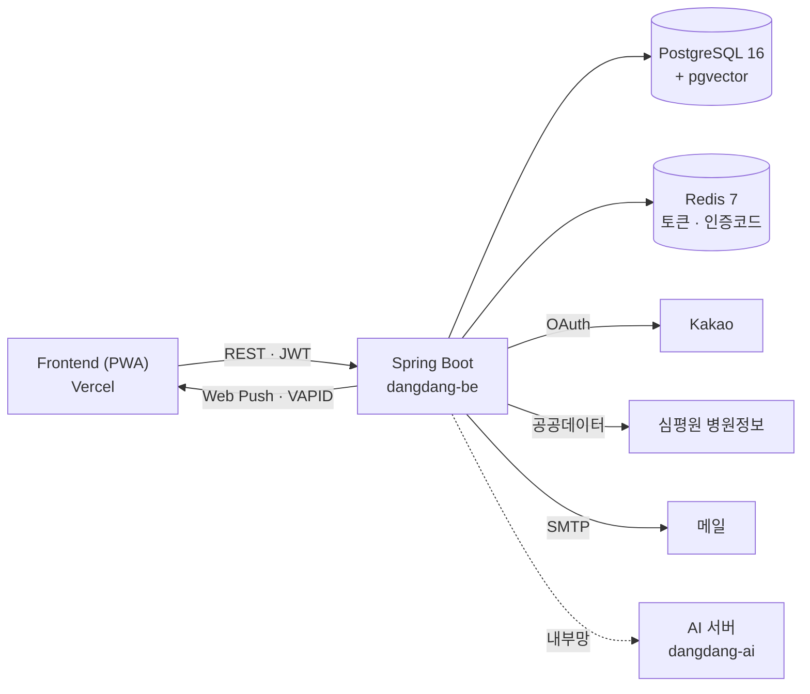
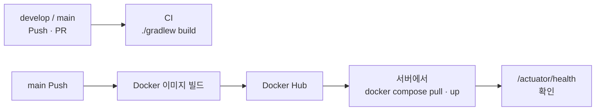

<div align="center">


# 당당 Backend

**임신성 당뇨 산모의 식사 · 혈당 · 측정 알림 · 병원 기준을 다루는 당당 API 서버**

[](https://dang-dang.site/swagger-ui.html)
[](https://dang-dang.vercel.app)
[](https://github.com/dangdang-2026/dangdang-be/actions)

</div>

<br/>

## 📌 한눈에 보기

- 산모가 **병원에서 받은 기준**(식후 몇 시간에 잴지, 목표 수치)을 버전으로 저장하고, 그 기준대로 **식후 측정 알림**을 보냅니다.
- 식사 기록과 혈당 기록을 이어서 저장해, "무엇을 먹고 잰 수치인지"가 남도록 합니다.
- 서버는 **판단하지 않습니다.** 혈당이 괜찮은지 판정하거나 권고하는 로직은 두지 않고, 기록 · 알림 · 정리만 담당합니다.

<br/>

## 🏗️ 구조



- **인증** — JWT Access Token + Refresh Token(Redis 저장), 이메일 인증 · 카카오 로그인
- **측정 알림** — 식사를 기록하면 병원 기준 시점에 알림을 예약하고, 스케줄러가 30초마다 보낼 알림을 찾아 **웹 푸시**로 보냅니다. 놓치면 10분 뒤 재알림, "10분 뒤 다시"(snooze) 지원
- **DB 스키마** — Hibernate 자동 생성 없이 **Flyway** 마이그레이션으로만 관리 (`ddl-auto: none`)
- **AI 서버** — 외부에 열지 않고 같은 Docker 네트워크에서 `http://ai:8000`으로만 호출

<br/>

## 🧩 도메인 · API

> 전체 요청 · 응답은 [Swagger](https://dang-dang.site/swagger-ui.html)에서 확인할 수 있습니다.

| 도메인 | 경로 | 하는 일 |
|---|---|---|
| `auth` | `/api/auth` | 이메일 인증 · 회원가입 · 로그인 · 카카오 로그인 · 토큰 재발급 · 비밀번호 재설정 |
| `user` | `/api/me` | 내 정보 · 이름 · 비밀번호 · 출산 예정일 · 약관/민감정보 동의 · 알림 설정 |
| `criteria` | `/api/criteria-versions` | 병원 기준(식후 측정 시간 · 재는 때 · 목표) 버전 관리 |
| `meal` | `/api/meals` | 식사 기록 CRUD |
| `reading` | `/api/readings` | 혈당 기록 CRUD |
| `reminder` | `/api/reminders` | 측정 알림 목록 · 열기 · 10분 뒤 다시 |
| `push` | `/api/push-subscriptions` | 웹 푸시 구독 · 해지 · 테스트 알림 |
| `notification` | `/api/notifications` | 알림함 목록 · 읽음 처리 |
| `caresite` | `/api/care-sites` | 다니는 병원 등록 · 수정 · 삭제, 심평원 병원 검색 |
| `community` | `/api/community/profiles` | 커뮤니티 프로필 · 닉네임 중복 확인 · 추천 |
| `pregnancy` | — | 임신 정보 (출산 예정일 등) |

모든 응답은 `BaseResponse` 형식으로 감싸고, 에러는 `GlobalExceptionHandler`에서 도메인별 에러 코드로 내려줍니다.

<br/>

## 🛠️ Tech Stack

| 분류 | 사용 기술 |
|---|---|
| Language · Framework | Java 21, Spring Boot 4.1, Spring MVC |
| Data | Spring Data JPA, PostgreSQL 16 (pgvector 이미지), Flyway |
| Cache · Store | Redis 7 (Refresh Token, 이메일 인증 코드, 로그인 시도 제한) |
| Security | Spring Security, JWT (jjwt) |
| 알림 | Web Push (VAPID), Spring Mail (SMTP), `@Scheduled` 스케줄러 |
| 외부 연동 | Kakao 로그인, 건강보험심사평가원 병원정보 API |
| 문서 · 모니터링 | springdoc-openapi (Swagger), Spring Boot Actuator, Dozzle |
| Build · Infra | Gradle Wrapper, Docker, Docker Compose, Docker Hub, GitHub Actions |

<br/>

## 📁 폴더 구조

```text
src/main/java/com/dangdang
├── domain/                 # 도메인별로 나눔
│   ├── auth/               #   controller · service · dto · exception · infra
│   ├── user/               #   controller · service · repository · entity · dto · enums · exception
│   ├── criteria/
│   ├── meal/
│   ├── reading/
│   ├── reminder/           #   + scheduler (측정 알림 발송)
│   ├── push/               #   + infra (VapidWebPushSender)
│   ├── notification/
│   ├── caresite/           #   + infra (심평원 병원 검색 클라이언트)
│   ├── community/
│   └── pregnancy/
└── global/
    ├── common/             # BaseResponse, BaseTimeEntity
    ├── config/             # Security · CORS · Swagger · Scheduling · WebPush 설정
    ├── exception/          # CustomException, GlobalExceptionHandler
    ├── filter/             # JwtAuthenticationFilter
    └── security/           # JWT 발급 · 검증

src/main/resources
├── application.yaml        # 공통 설정 (local · prod 프로필 분리)
├── db/migration/           # Flyway 마이그레이션 (V1__…, V20261110_1__…)
└── mail/                   # 메일 템플릿

docker/
├── Dockerfile
├── docker-compose.local.yml   # 로컬 DB · Redis
├── docker-compose.yml         # 운영 app · db · redis · ai · dozzle
└── .env.example
```

<br/>

## 💻 로컬에서 실행하기

**필요한 것:** Java 21, Docker (Gradle은 Wrapper가 있어 따로 설치하지 않아도 됩니다)

```bash
git clone https://github.com/dangdang-2026/dangdang-be.git
cd dangdang-be
git switch develop

# 1. DB · Redis 띄우기 (PostgreSQL 5432, Redis 6379)
docker compose -f docker/docker-compose.local.yml up -d

# 2. 서버 실행 (local 프로필)
./gradlew bootRun --args='--spring.profiles.active=local'
```

| 확인할 곳 | 주소 |
|---|---|
| Swagger | http://localhost:8080/swagger-ui.html |
| Health Check | http://localhost:8080/actuator/health |

로컬 DB 기본값은 `dangdang / dangdang / dangdang` (DB명 / 계정 / 비밀번호)입니다.
테이블은 서버가 켜질 때 Flyway가 자동으로 만듭니다.

### 테스트

```bash
./gradlew test     # 테스트만
./gradlew build    # CI와 같은 검사 (컴파일 + 테스트)
```

<br/>

## 🔐 환경변수

운영 값은 깃에 올리지 않고 GitHub Secrets `ENV_PROD`에만 둡니다. 견본은 [`docker/.env.example`](docker/.env.example)에 있습니다.

| 분류 | 변수 |
|---|---|
| DB · Redis | `DB_URL` `DB_USER` `DB_PASSWORD` `REDIS_HOST` `REDIS_PORT` `REDIS_PASSWORD` |
| 인증 | `JWT_SECRET` `JWT_COOKIE_SECURE` `KAKAO_REST_API_KEY` `KAKAO_CLIENT_SECRET` |
| 웹 푸시 | `VAPID_PUBLIC_KEY` `VAPID_PRIVATE_KEY` `VAPID_SUBJECT` `PUSH_SENDER` |
| 메일 | `MAIL_USERNAME` `MAIL_PASSWORD` `MAIL_SENDER` |
| 외부 API | `HIRA_SERVICE_KEY` |
| 프론트 연결 | `FRONT_BASE_URL` `CORS_ALLOWED_ORIGINS` |

<br/>

## 🚀 배포



- **CI** — `develop`, `main`에 Push · PR이 생기면 `./gradlew build`
- **CD** — `main`에 Push되면 이미지를 Docker Hub에 올리고, SSH로 서버에 접속해 새 이미지로 교체한 뒤 Health Check로 정상 실행을 확인
- **운영 컨테이너** — `app`(Spring) · `db`(PostgreSQL) · `redis` · `ai`(FastAPI) · `dozzle`(로그 뷰어)

<br/>

## 🤝 협업 규칙

### 브랜치

```text
main        배포 브랜치 — 직접 작업하지 않음, Push되면 자동 배포
└── develop 개발 통합 브랜치 — 작업 브랜치는 여기서 만듦
    ├── feat/10-email-login
    ├── api/12-meal-record
    └── fix/14-login-error
```

- 이름: `prefix/이슈번호-작업내용` (영문 소문자, `-`로 구분, `#` 사용 안 함)
- prefix: `feat` `api` `fix` `hotfix` `refactor` `test` `docs` `deploy` `chore`
- 병합: 작업 브랜치 → `develop`은 **Squash and merge**, CI 통과 + 리뷰 1명 승인 후

### 커밋

```text
이모지 Type: 작업 내용      예) ✨ Feat: 이메일 회원가입 기능 구현
```

| 이모지 | Type | 설명 | | 이모지 | Type | 설명 |
|:---:|---|---|---|:---:|---|---|
| 🎉 | `Start` | 프로젝트 시작 | | 🔀 | `Merge` | 브랜치 병합 |
| ✨ | `Feat` | 새 기능 | | 🚀 | `Deploy` | 배포 |
| 🐛 | `Fix` | 버그 수정 | | 🚚 | `Rename` | 이름 · 위치 변경 |
| 🚑 | `Hotfix` | 긴급 수정 | | 🔥 | `Remove` | 파일 · 코드 삭제 |
| ♻️ | `Refactor` | 리팩토링 | | ⏪ | `Revert` | 되돌리기 |
| 🔧 | `Settings` | 설정 변경 | | ✅ | `Test` | 테스트 |
| 🗃️ | `Comment` | 주석 | | 📝 | `Docs` | 문서 |
| ➕ | `Dependency/Plugin` | 의존성 추가 | | | | |

- 한 커밋에는 하나의 변경만, 메시지는 한국어로, 끝에 마침표 없이

<br/>

## 👥 Team

|  |  |
|:---:|:---:|
| **김승민** · [@seungminng123](https://github.com/seungminng123) | **임다현** · [@dahyun0423](https://github.com/dahyun0423) |
| Frontend · Backend | PM · AI · Infra |

<div align="center">

<br/>

[Frontend](https://github.com/dangdang-2026/dangdang-fe) · **Backend** · [AI](https://github.com/dangdang-2026/dangdang-ai) · [Organization](https://github.com/dangdang-2026)

</div>
