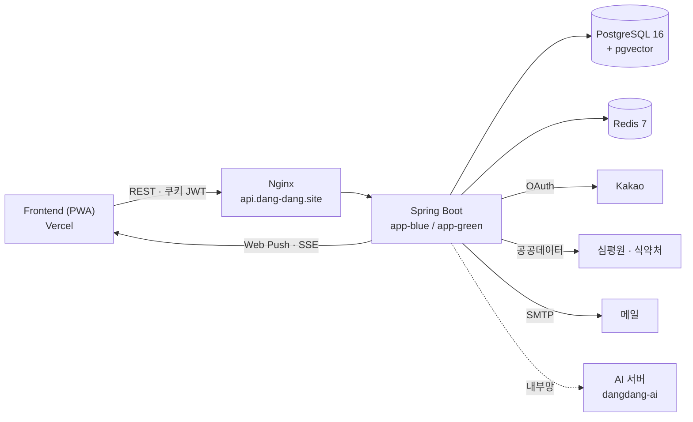
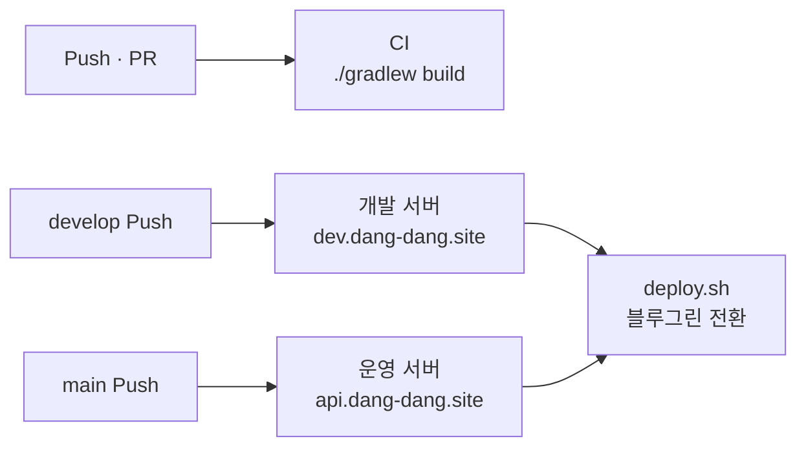

<div align="center">


# 당당 Backend

**병원에서 받은 기준을 하루 일정으로 바꿔 주는<br/>당당의 API 서버예요**

[](https://api.dang-dang.site/swagger-ui.html)
[](https://dang-dang.site)
[](https://github.com/dangdang-2026/dangdang-be/actions)

[한눈에 보기](#-한눈에-보기) · [구조](#️-구조) · [API](#-api) · [실행하기](#-로컬에서-실행하기) · [배포](#-배포) · [협업 규칙](#-협업-규칙)

</div>

<br/>

## 📌 한눈에 보기

| 영역 | 이렇게 도와요 |
|---|---|
| 🩸 **기록** | 식사와 혈당을 이어서 저장해요.<br/>무엇을 먹고 잰 수치인지 남아요. |
| ⏰ **알림** | 병원 기준 시점에 측정 알림을 보내요.<br/>놓치면 10분 뒤 한 번 더 알려요. |
| 🏥 **진료** | 진료 전에는 기록과 물어볼 것을<br/>리포트 한 장으로 모아 줘요. |
| 💬 **커뮤니티 · 소식** | 산모끼리 나누는 글과<br/>공식 지침 카드뉴스를 다뤄요. |
| 🤖 **AI 보조** | 음식 사진 후보 · 챗봇 · 진료 메모 정리는<br/>내부 AI 서버에 맡겨요. |

> [!IMPORTANT]
> 서버는 **판단하지 않아요.** 혈당이 괜찮은지 판정하거나 권고하는 로직은 두지 않고,
> 기록 · 알림 · 정리만 맡아요.

<br/>

## 🏗️ 구조



| 부분 | 어떻게 |
|---|---|
| **인증** | JWT(Access · Refresh)를 HttpOnly 쿠키로<br/>이메일 인증 · 카카오 로그인 |
| **측정 알림** | 스케줄러가 30초마다 보낼 알림을 찾아 웹 푸시로<br/>서버가 여러 대여도 한 대만 돌아요 (ShedLock) |
| **앱 안 알림** | 알림함에 새 알림이 생기면 열린 앱으로 바로 (SSE) |
| **DB 스키마** | Flyway 마이그레이션으로만 관리 (`ddl-auto: validate`) |
| **AI 서버** | 밖에 열지 않고 `http://ai:8000`으로만 불러요<br/>동의와 하루 횟수는 Spring이 먼저 확인해요 |

<br/>

## 🧩 API

전체 요청 · 응답은 [Swagger](https://api.dang-dang.site/swagger-ui.html)에 있어요.<br/>
응답은 모두 `BaseResponse`로 감싸고, 에러는 도메인별 코드(`AUTH_40101` 등)로 내려가요.

**기록 · 알림**

| 경로 | 하는 일 |
|---|---|
| `/api/criteria-versions` | 병원 기준 (식후 측정 시간 · 목표) 버전 관리 |
| `/api/today` · `/api/records` | 오늘 화면 · 기록 모아 보기 |
| `/api/meals` · `/api/foods` | 식사 기록 · 음식 검색 · 사진으로 음식 후보 |
| `/api/me/foods` · `/api/me/meal-plan` | 내 음식 · 식단 계획 |
| `/api/readings` | 혈당 기록 |
| `/api/reminders` · `/api/push-subscriptions` | 측정 알림 · 10분 뒤 다시 · 웹 푸시 구독 |
| `/api/notifications` | 알림함 · 읽음 · 실시간 받기 (SSE) |

**진료 · 출산 · 챗봇**

| 경로 | 하는 일 |
|---|---|
| `/api/care-sites` | 다니는 병원 등록 · 병원 검색 |
| `/api/visits` · `/api/visit-reports` | 진료 일정 · 물어볼 것 · 메모 AI 정리 · 리포트 |
| `/api/me/delivery-date` · `/api/postpartum` | 입원 · 출산 · 산후 검사 알림 · 당졸 |
| `/api/chat/messages` | 당당이에게 물어보기 |

**커뮤니티 · 소식**

| 경로 | 하는 일 |
|---|---|
| `/api/posts` · `/api/comments` | 글 · 댓글 · 공감 · 투표 · 임시 글 · 올리기 전 AI 확인 |
| `/api/me/posts` 외 | 내가 쓴 글 · 댓글 · 공감한 글 · 개수 |
| `/api/community` · `/api/blocks` · `/api/reports` | 프로필 · 안 보기 · 신고 · 이용 제한 · 이의 신청 |
| `/api/cards` · `/api/announcements` | 당당 소식 카드뉴스 · 스플래시 소식 |

**계정 · 운영**

| 경로 | 하는 일 |
|---|---|
| `/api/auth` | 이메일 인증 · 가입 · 로그인 · 카카오 · 토큰 재발급 · 비밀번호 재설정 |
| `/api/me` | 내 정보 · 동의 · 출산 예정일 · 알림 설정 · 탈퇴 |
| `/api/admin/**` | 운영자 전용 — 카드 · 소식 · 신고 처리함 · 이용 제한 |

<br/>

## 🛠️ Tech Stack

| 분류 | 사용 기술 |
|---|---|
| Language · Framework | Java 21 · Spring Boot 4.1 · Spring MVC |
| Data | Spring Data JPA · PostgreSQL 16 (pgvector) · Flyway |
| Cache · Store | Redis 7 — Refresh Token · 인증 코드 · 로그인 시도 제한 · AI 하루 횟수 |
| Security | Spring Security · JWT (jjwt) |
| 알림 | Web Push (VAPID) · SSE · Spring Mail · `@Scheduled` + ShedLock |
| 외부 연동 | Kakao 로그인 · 심평원 병원정보 · 식약처 음식 DB |
| 문서 · 모니터링 | springdoc-openapi (Swagger) · Actuator · Dozzle |
| Build · Infra | Gradle · Docker Compose · Docker Hub · GitHub Actions · Nginx |

<br/>

## 📁 폴더 구조

<details>
<summary><b>펼쳐 보기</b></summary>

```text
src/main/java/com/dangdang
├── domain/                 # 도메인별로 나눔 (controller · service · repository · entity · dto · exception)
│   ├── auth/ · user/
│   ├── criteria/ · record/ · meal/ · food/ · myfood/ · mealplan/ · reading/
│   ├── reminder/           #   + scheduler (측정 알림 발송)
│   ├── push/ · notification/   #   + 웹 푸시 · SSE
│   ├── caresite/ · visit/ · pregnancy/ · postpartum/
│   ├── chat/
│   ├── post/ · comment/ · community/ · report/
│   └── card/ · announcement/
└── global/
    ├── ai/                 # AI 서버 호출 · 동의 · 하루 횟수 (AiGuard)
    ├── common/             # BaseResponse, BaseTimeEntity
    ├── config/             # Security · CORS · Swagger · Scheduling(ShedLock) · Async
    ├── exception/          # CustomException, GlobalExceptionHandler
    ├── filter/ · security/ # JWT 발급 · 검증

src/main/resources
├── application.yaml        # 공통 설정 (local · prod 프로필 분리)
├── db/migration/           # Flyway (V1__… · V20261124_96__…)
└── mail/                   # 메일 템플릿

docker/
├── docker-compose.local.yml   # 로컬 DB · Redis
├── docker-compose.yml         # 운영 app-blue · app-green · db · redis · ai · dozzle
├── deploy.sh                  # 블루그린 전환
└── .env.example
```

</details>

<br/>

## 💻 로컬에서 실행하기

**필요한 것** — Java 21 · Docker (Gradle은 Wrapper가 있어요)

```bash
git clone https://github.com/dangdang-2026/dangdang-be.git
cd dangdang-be && git switch develop

# 1. DB · Redis 띄우기 (PostgreSQL 5432 · Redis 6379)
docker compose -f docker/docker-compose.local.yml up -d

# 2. 서버 실행 (local 프로필)
./gradlew bootRun --args='--spring.profiles.active=local'
```

| 확인할 곳 | 주소 |
|---|---|
| Swagger | http://localhost:8080/swagger-ui.html |
| Health Check | http://localhost:8080/actuator/health |

- 로컬 DB 기본값은 `dangdang / dangdang / dangdang` (DB명 / 계정 / 비밀번호)예요.
- 테이블은 서버가 켜질 때 Flyway가 만들어요.

```bash
./gradlew test     # 테스트만
./gradlew build    # CI와 같은 검사 (컴파일 + 테스트)
```

<br/>

## 🔐 환경변수

견본은 [`docker/.env.example`](docker/.env.example)에 있어요.<br/>
운영 값은 깃에 올리지 않고 GitHub Secrets(`ENV_PROD` · 개발 서버 `ENV_DEV`)에만 둬요.

| 분류 | 변수 |
|---|---|
| DB · Redis | `DB_URL` `DB_USER` `DB_PASSWORD` `REDIS_HOST` `REDIS_PORT` `REDIS_PASSWORD` |
| 인증 | `JWT_SECRET` `JWT_COOKIE_SECURE` `KAKAO_REST_API_KEY` `KAKAO_CLIENT_SECRET` |
| 웹 푸시 | `VAPID_PUBLIC_KEY` `VAPID_PRIVATE_KEY` `VAPID_SUBJECT` `PUSH_SENDER` |
| 메일 | `MAIL_USERNAME` `MAIL_PASSWORD` `MAIL_SENDER` |
| AI 서버 | `AI_BASE_URL` `INTERNAL_TOKEN` |
| 외부 API | `HIRA_SERVICE_KEY` |
| 프론트 연결 | `FRONT_BASE_URL` `CORS_ALLOWED_ORIGINS` |

<br/>

## 🚀 배포



| 단계 | 하는 일 |
|---|---|
| **CI** | `develop` · `main`에 Push · PR이 생기면 `./gradlew build` |
| **CD** | `develop` → 개발 서버 · `main` → 운영 서버<br/>이미지를 Docker Hub에 올리고 서버의 `deploy.sh` 실행 |
| **무중단 배포** | 쉬던 색(`app-blue` ↔ `app-green`)을 새 이미지로 띄우고<br/>Health Check가 통과하면 Nginx를 넘겨요<br/>실패하면 이전 색 그대로예요 |
| **운영 컨테이너** | `app-blue` · `app-green` (한 번에 하나) · `db` · `redis` · `ai` · `dozzle` |
| **백업** | DB를 매일 새벽 암호화해서 백업하고 7일 보관해요 |

<br/>

## 🤝 협업 규칙

**브랜치**

```text
main        배포 브랜치 — 직접 작업하지 않음, Push되면 자동 배포
└── develop 개발 통합 브랜치 — 작업 브랜치는 여기서 만듦 (Push되면 개발 서버 배포)
    ├── feature/119-fe-requests
    └── fix/105-api-domain
```

- 이름은 `prefix/이슈번호-작업내용` (영문 소문자, `-`로 구분)
- 작업 브랜치 → `develop`은 **Squash and merge** · CI 통과 + 리뷰 1명 승인 후

**커밋** — `:이모지: Type: 작업 내용` &nbsp; 예) `:sparkles: Feat: 이메일 회원가입 기능 구현`

- 한 커밋에는 하나의 변경만 · 메시지는 한국어로 · 끝에 마침표 없이

<details>
<summary><b>Type 16가지 보기</b></summary>

| 이모지 | Type | 설명 | | 이모지 | Type | 설명 |
|:---:|---|---|---|:---:|---|---|
| 🎉 | `Start` | 프로젝트 시작 | | 🔀 | `Merge` | 브랜치 병합 |
| ✨ | `Feat` | 새 기능 | | 🚀 | `Deploy` | 배포 |
| 🐛 | `Fix` | 버그 수정 | | 🚚 | `Rename` | 이름 · 위치 변경 |
| 🚑 | `Hotfix` | 긴급 수정 | | 🔥 | `Remove` | 파일 · 코드 삭제 |
| ♻️ | `Refactor` | 리팩토링 | | ⏪ | `Revert` | 되돌리기 |
| 🔧 | `Settings` | 설정 변경 | | ✅ | `Test` | 테스트 |
| 🗃️ | `Comment` | 주석 | | 📝 | `Docs` | 문서 |
| ➕ | `Dependency/Plugin` | 의존성 추가 | | | | |

</details>

<br/>

## 👥 Team

|  |  |
|:---:|:---:|
| **김승민** · [@seungminng123](https://github.com/seungminng123) | **임다현** · [@dahyun0423](https://github.com/dahyun0423) |
| Frontend · Backend | PM · AI · Infra |

<div align="center">

<br/>

[Frontend](https://github.com/dangdang-2026/dangdang-fe) · **Backend** · [AI](https://github.com/dangdang-2026/dangdang-ai) · [Organization](https://github.com/dangdang-2026)

</div>
